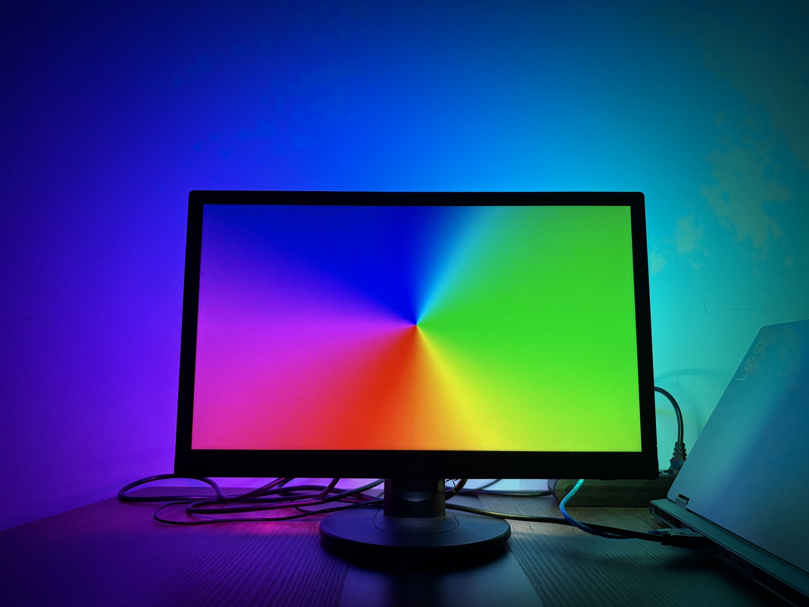
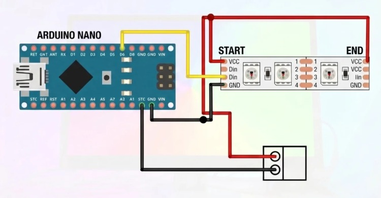
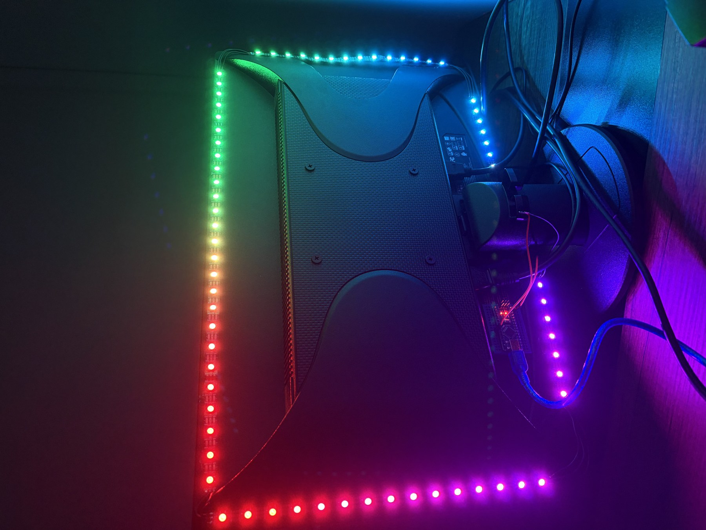
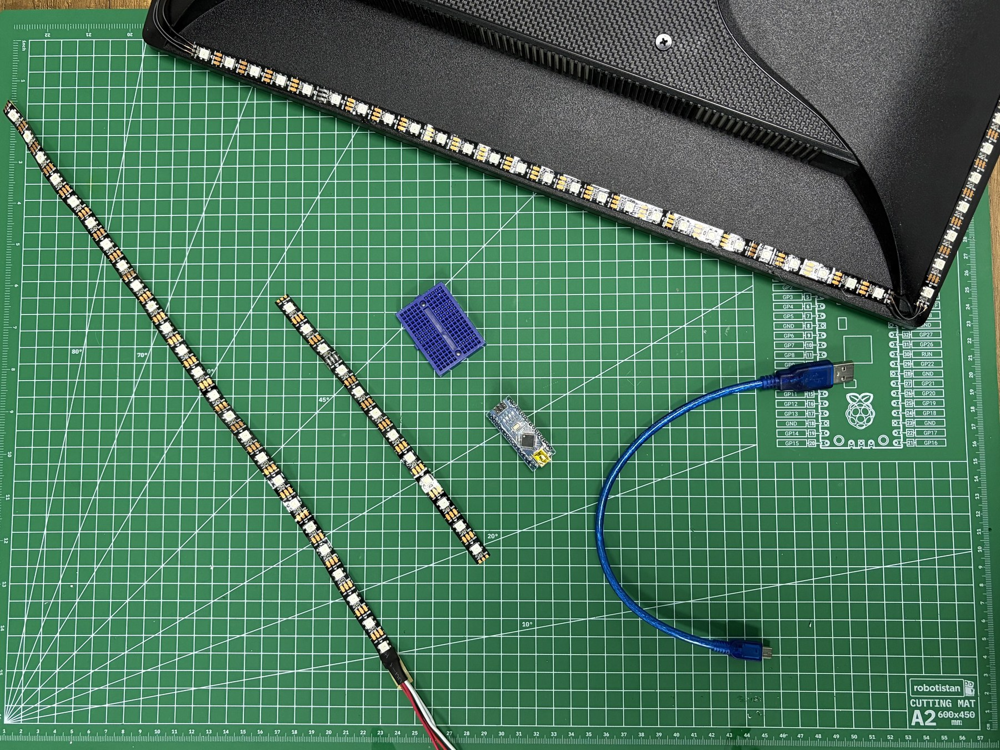

<div align="center">
  <h1>Dynamic RGB LED Monitor Backlighting</h1>
  <p><strong>A DIY Ambilight-style system that extends on-screen colors beyond the monitor.</strong></p>
  <p></p>
  <p><em>Screen colors sampled by desktop software are sent to an Arduino Nano and displayed on a WS2812B strip.</em></p>
</div>

## Project Overview

This project creates dynamic ambient lighting behind a monitor. Desktop software such as Prismatik divides the screen edges into regions, samples their average RGB colors, and sends the data to an Arduino Nano over USB serial. The Nano validates Adalight packets and uses the FastLED library to update the corresponding LEDs on a WS2812B addressable strip.

The result is a color-matched glow around the monitor that can make games, films, and other content feel more immersive.

## How It Works

1. Desktop software samples the colors from regions around the screen.
2. The software sends the color data to the Arduino using the Adalight serial protocol.
3. The Arduino checks the packet header and checksum.
4. FastLED updates the WS2812B strip so its colors follow the screen.

## Components

- Arduino Nano (a compatible CH340-based Nano board can also be used)
- WS2812B addressable RGB LED strip
- Regulated 5 V DC power supply, rated for the strip's actual current demand
- Mini breadboard and jumper wires
- Computer with a compatible screen-sampling application, such as Prismatik

## Wiring

| Connection | Destination |
| --- | --- |
| Arduino Nano D6 | WS2812B DIN at the strip input |
| External supply +5 V | WS2812B +5 V at both the beginning and end of the strip |
| External supply GND | WS2812B GND and Arduino Nano GND (shared ground) |

<p align="center"></p>
<p align="center"><em>Wiring diagram: connect the Nano data output to DIN, and share ground between the Nano, LED strip, and external supply.</em></p>

### Power Note

The original parts list mentions a 5 V, 2 A adapter. Choose a supply that can safely provide the current required by your strip length and brightness; a long strip at high brightness may need more than 2 A. Inject power at both ends as shown, connect all grounds together, and do not power the LED strip from the Nano's 5 V pin.

## Firmware

The Arduino sketch is provided as [`ambilight_rgb_led.ino`](ambilight_rgb_led.ino). It is configured for 120 WS2812B LEDs, data on pin D6, GRB color order, and a 115200 baud serial connection.

Before uploading:

1. Install the **FastLED** library in the Arduino IDE.
2. Set `NUM_LEDS` to the number of LEDs in your strip.
3. Connect the Nano to the computer and select its board and serial port.
4. Upload the sketch.
5. Configure the desktop capture software to use the Adalight protocol, the Nano's serial port, and 115200 baud.

The LED count and screen-region layout in the desktop software should match your physical installation.

<details>
<summary>View the Arduino sketch</summary>

```cpp
#include <FastLED.h>

#define NUM_LEDS 120  // Set this to match the number of LEDs in your strip
#define DATA_PIN 6
#define SERIAL_RATE 115200

CRGB leds[NUM_LEDS];
uint8_t prefix[] = {'A', 'd', 'a'};

void setup() {
  FastLED.addLeds<WS2812B, DATA_PIN, GRB>(leds, NUM_LEDS);
  Serial.begin(SERIAL_RATE);
  Serial.print("Ada\n");  // Announce that the controller is ready
}

void loop() {
  for (int i = 0; i < sizeof(prefix); ++i) {
  waitLoop:
    while (!Serial.available());
    if (prefix[i] == Serial.read()) continue;
    i = 0;
    goto waitLoop;
  }

  while (!Serial.available());
  uint8_t hi = Serial.read();
  while (!Serial.available());
  uint8_t lo = Serial.read();
  while (!Serial.available());
  uint8_t chk = Serial.read();

  if (chk == (hi ^ lo ^ 0x55)) {
    Serial.readBytes((char*)leds, NUM_LEDS * 3);
    FastLED.show();
  }
}
```

</details>

## Build Photos

<table>
  <tr>
    <td align="center" width="50%"><br><em>Addressable LED strip mounted around the back of the monitor.</em></td>
    <td align="center" width="50%"><br><em>LED strip and controller components during assembly.</em></td>
  </tr>
</table>

## Project Article

This repository documents my project in English. For the original Turkish article and additional background, see [Dynamic RGB LED Project for Your Monitor: Colors Beyond the Screen](https://maker.robotistan.com/monitorunuz-icin-dinamik-rgb-led-projesi-arduino-ile-sinirlari-asan-renkler/).

## Possible Extensions

- Add a static-lighting mode for use when the computer is off.
- Add a microphone module for audio-reactive lighting.
- Add game integrations for custom status effects.
