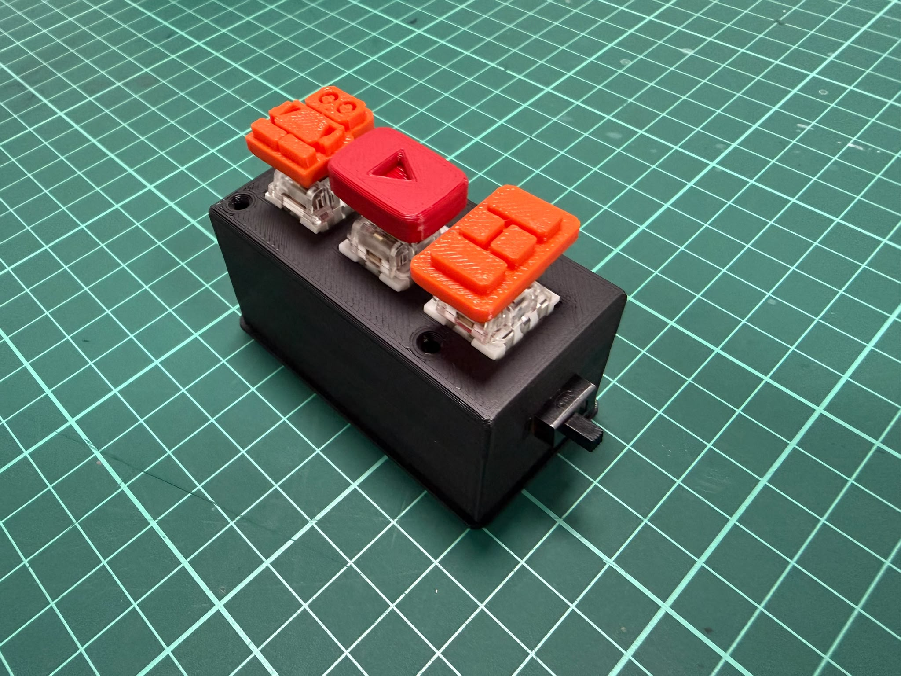
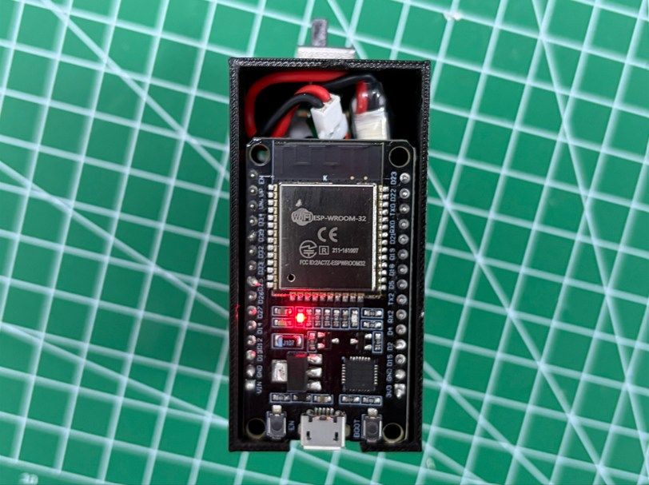
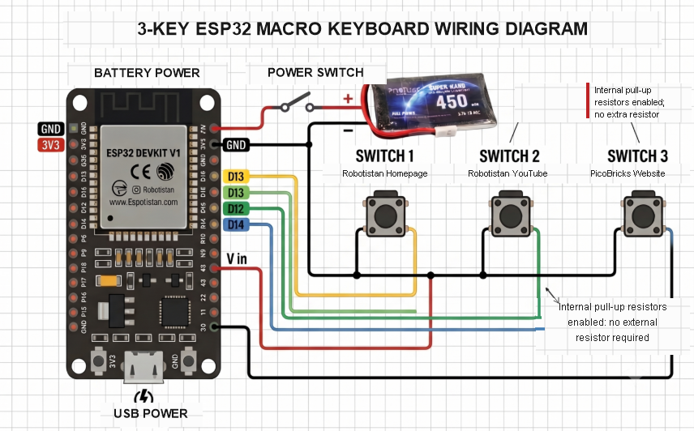

# ESP32 Bluetooth Macro Keyboard

A compact, three-button Bluetooth macro keyboard built with an ESP32 DevKit V1. Each button sends a configurable keyboard shortcut to a paired computer.

  

## Features

- Connects to a computer as a Bluetooth Low Energy keyboard (HID).
- Sends one keyboard shortcut per button press.
- Uses the ESP32's internal pull-up resistors, so no external pull-up resistors are needed.
- Fits in a compact 3D-printed enclosure and can run from a single-cell Li-Po battery.

## Build photos

  
  &nbsp;&nbsp;
  

## Parts

- ESP32 DevKit V1
- 3 tactile push buttons
- 3.7 V, 1S Li-Po battery (450 mAh in the pictured build)
- Toggle power switch
- Jumper wires
- 3D-printed enclosure and keycaps

## Wiring

The buttons share a common ground connection. Connect their other legs to the ESP32 pins shown below.

| Function | ESP32 connection |
| --- | --- |
| Button 1 | D13 to GND |
| Button 2 | D12 to GND |
| Button 3 | D14 to GND |
| Battery negative | GND |
| Battery positive | VIN through the toggle switch |

The firmware configures the button pins as INPUT_PULLUP. A button press therefore reads LOW.

  

> **Power note:** The original build routes the 3.7 V Li-Po positive lead through a switch to VIN. VIN requirements differ between ESP32 DevKit variants. Check the recommended input range for your specific board before connecting the battery; use a suitable protected battery and an appropriate charging solution.

## Firmware

The sketch is in [src/esp32_macro_keyboard.ino](src/esp32_macro_keyboard.ino). It uses the [ESP32 BLE Keyboard library](https://github.com/T-vK/ESP32-BLE-Keyboard).

The default shortcuts are:

| Button | Pins | Shortcut |
| --- | --- | --- |
| 1 | D13 to GND | Ctrl + Alt + J |
| 2 | D12 to GND | Ctrl + Alt + K |
| 3 | D14 to GND | Ctrl + Alt + L |

### Setup

1. Install the ESP32 board support package in Arduino IDE.
2. Install the **ESP32 BLE Keyboard** library.
3. Open src/esp32_macro_keyboard.ino, select the ESP32 board and its serial port, then upload the sketch.
4. Pair **Robotistan Macro** from your computer's Bluetooth settings.
5. Assign the matching Ctrl + Alt shortcuts to the desktop shortcuts or applications you want to launch.

Change the pin definitions, Bluetooth device name, or key combinations in the sketch to customize the keypad. The board must support Bluetooth Low Energy HID for the keyboard to pair.

## Reference

Project information and the original wiring concept: [ESP32 Bluetooth Macro Keyboard (Robotistan Maker)](https://maker.robotistan.com/esp32-ile-bluetooth-makro-klavye-yapimi/).

The build photographs in this repository were supplied by the project author.
