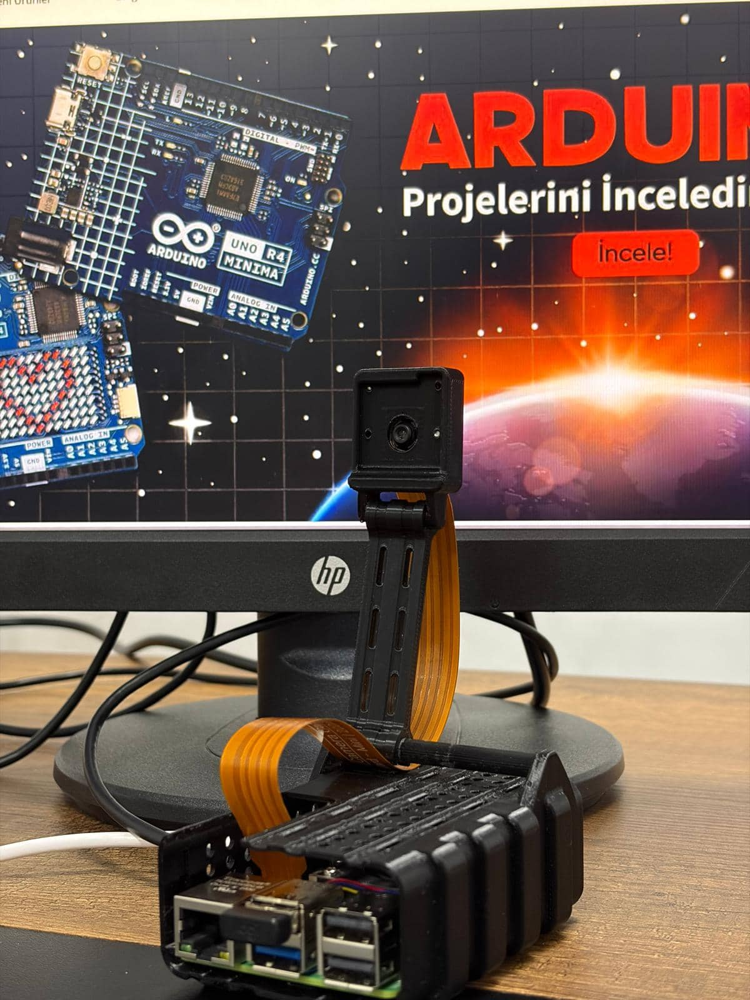
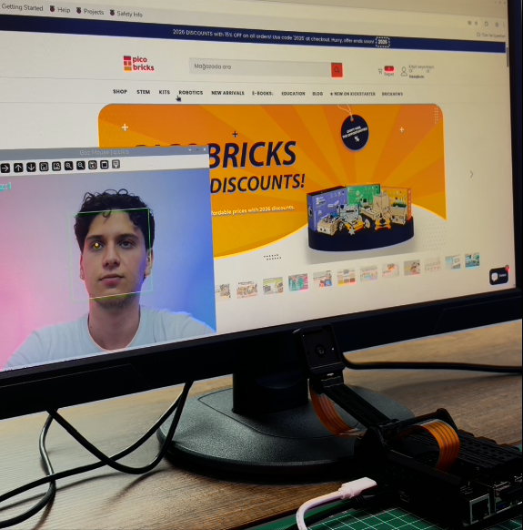

# Eye Tracking Mouse

Control the on-screen pointer with your gaze and click by blinking. This Raspberry Pi 5 project combines camera input, OpenCV-based eye tracking, and PyAutoGUI mouse control.

## Project at a Glance

The camera captures a 640 × 480 preview. OpenCV detects a face and eye region, then estimates the pupil position from the image. NumPy maps that position to screen coordinates, and a rolling average smooths pointer movement. A blink triggers a mouse click.

<p align="center">
  
</p>
<p align="center"><em>Raspberry Pi and camera hardware used in the project.</em></p>

<p align="center">
  
</p>
<p align="center"><em>Live eye tracking and cursor control in use.</em></p>

## How It Works

1. Picamera2 captures frames from the Raspberry Pi camera.
2. Haar cascade classifiers locate a face and the eye region.
3. OpenCV estimates the pupil position; NumPy maps it to the display dimensions.
4. PyAutoGUI moves the pointer using a rolling average of recent positions. A detected blink triggers a click.

## Hardware

- Raspberry Pi 5
- Raspberry Pi Camera Module 3
- Active cooler for Raspberry Pi 5
- Display and input peripherals for setup

## Software and Setup

The project uses Python 3.11, OpenCV, NumPy, PyAutoGUI, and Picamera2. The supplied setup notes recommend creating an isolated Conda environment:

```bash
conda create -n eye-mouse python=3.11 -y
conda activate eye-mouse
pip install opencv-python pyautogui numpy picamera2
```

Picamera2 must be available to the Python environment and configured for the Raspberry Pi camera. After setup, run:

```bash
python eye_tracking_mouse.py
```

Press `q` in the preview window to quit.

## Python Code

The complete program is also available as [`eye_tracking_mouse.py`](eye_tracking_mouse.py). The cascade paths use OpenCV's bundled data directory, avoiding machine-specific home-directory paths.

> **Fail-safe note:** The supplied program sets `pyautogui.FAILSAFE = False`, which disables PyAutoGUI's corner fail-safe. Consider setting it to `True` while testing to restore the emergency stop behavior.

```python
import cv2
import pyautogui
import numpy as np
from picamera2 import Picamera2

SCREEN_W, SCREEN_H = pyautogui.size()
SMOOTHING = 20
pyautogui.FAILSAFE = False

face_cascade = cv2.CascadeClassifier(
    cv2.data.haarcascades + "haarcascade_frontalface_default.xml")
eye_cascade = cv2.CascadeClassifier(
    cv2.data.haarcascades + "haarcascade_eye.xml")

picam2 = Picamera2()
config = picam2.create_preview_configuration(
    main={"format": "XBGR8888", "size": (640, 480)})
picam2.configure(config)
picam2.start()

pos_history = []
blink_counter = 0
prev_eye_h = None

pyautogui.moveTo(SCREEN_W // 2, SCREEN_H // 2)
print("Camera started; press q to quit")

def find_pupil(eye_roi_gray):
    eye_roi_gray = cv2.GaussianBlur(eye_roi_gray, (7, 7), 0)
    _, thresh = cv2.threshold(
        eye_roi_gray, 40, 255, cv2.THRESH_BINARY_INV)
    contours, _ = cv2.findContours(
        thresh, cv2.RETR_EXTERNAL, cv2.CHAIN_APPROX_SIMPLE)
    if contours:
        largest = max(contours, key=cv2.contourArea)
        M = cv2.moments(largest)
        if M["m00"] > 0:
            cx = int(M["m10"] / M["m00"])
            cy = int(M["m01"] / M["m00"])
            return cx, cy
    return None

while True:
    frame = picam2.capture_array()

    # The XBGR8888 frame has four channels; use the first three as BGR.
    frame = frame[:, :, :3]
    frame = cv2.flip(frame, 1)
    gray = cv2.cvtColor(frame, cv2.COLOR_BGR2GRAY)
    h, w = frame.shape[:2]

    faces = face_cascade.detectMultiScale(
        gray, 1.3, 5, minSize=(80, 80))

    for (fx, fy, fw, fh) in faces:
        cv2.rectangle(frame, (fx, fy), (fx + fw, fy + fh),
                      (0, 255, 0), 1)
        roi_gray = gray[fy:fy + fh, fx:fx + fw]
        eyes = eye_cascade.detectMultiScale(
            roi_gray, 1.1, 10, minSize=(20, 20))

        if len(eyes) > 0:
            eyes = [e for e in eyes if e[1] < fh * 0.55]
            if len(eyes) == 0:
                continue

            eyes = sorted(eyes, key=lambda e: e[0])
            ex, ey, ew, eh = eyes[0]
            eye_roi_gray = roi_gray[ey:ey + eh, ex:ex + ew]
            pupil = find_pupil(eye_roi_gray)

            if pupil:
                px, py = pupil
                eye_cx = fx + ex + px
                eye_cy = fy + ey + py
            else:
                eye_cx = fx + ex + ew // 2
                eye_cy = fy + ey + eh // 2

            cv2.circle(frame, (eye_cx, eye_cy), 4,
                       (0, 200, 255), -1)

            sx = int(np.interp(
                eye_cx, [w * 0.38, w * 0.62], [0, SCREEN_W]))
            sy = int(np.interp(
                eye_cy, [h * 0.28, h * 0.62], [0, SCREEN_H]))

            pos_history.append((sx, sy))
            if len(pos_history) > SMOOTHING:
                pos_history.pop(0)

            if len(pos_history) >= SMOOTHING:
                ax = int(np.mean([p[0] for p in pos_history]))
                ay = int(np.mean([p[1] for p in pos_history]))
                pyautogui.moveTo(ax, ay, duration=0)

            if prev_eye_h is not None:
                if eh < prev_eye_h * 0.75:
                    blink_counter += 1
                else:
                    if blink_counter >= 1:
                        pyautogui.click()
                        cv2.putText(
                            frame, "CLICKED!", (20, 50),
                            cv2.FONT_HERSHEY_SIMPLEX, 1,
                            (0, 255, 0), 2)
                    blink_counter = 0
            prev_eye_h = eh

        break

    cv2.putText(frame, f"Faces: {len(faces)}", (10, 30),
                cv2.FONT_HERSHEY_SIMPLEX, 0.7, (255, 255, 0), 2)
    cv2.imshow("Eye Mouse | q: quit", frame)

    if cv2.waitKey(1) & 0xFF == ord('q'):
        break

picam2.stop()
cv2.destroyAllWindows()
```

## Tuning

- Increase or decrease `SMOOTHING` to adjust pointer stability and responsiveness.
- Adjust the `np.interp` camera-frame ranges to match the camera position and comfortable gaze area.
- The blink threshold is controlled by `eh < prev_eye_h * 0.75`.

## Project Files

- [`eye_tracking_mouse.py`](eye_tracking_mouse.py) - Python application
- `images/eye-tracking-setup.jpg` - Raspberry Pi and camera setup
- `images/eye-tracking-demo.png` - live eye tracking demonstration

## Blog Post

- [Controlling a Mouse with Eye Movements Using Raspberry Pi 5](https://maker.robotistan.com/raspberry-pi-5-ile-goz-hareketleriyle-mouse-kontrolu/)
