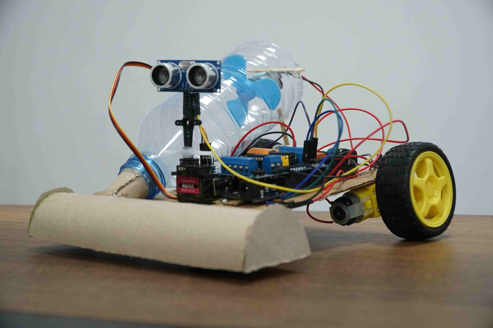
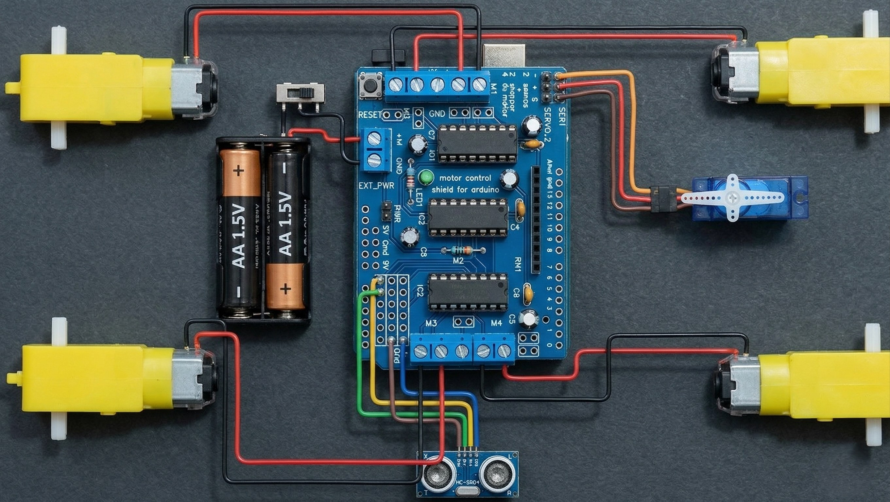

# Smart Cleaning Robot

An Arduino-based mobile cleaning robot prototype developed during a Robotistan internship. The robot combines wheeled movement with a fan-assisted cleaning mechanism and uses ultrasonic sensing to detect obstacles and change direction.

## Project Overview

The goal of this project is to build a low-cost robot that can move across a floor while collecting dust and small particles. A fan or vacuum motor provides the cleaning action, while the drive motors move the robot. When an obstacle is detected, the robot can stop, turn, and continue moving.

The prototype demonstrates the integration of mobile robotics, motor control, and a basic cleaning mechanism using accessible components.

## How It Works

1. The Arduino controls the drive motors through an L293D-based motor shield.
2. The robot moves forward while the cleaning fan runs to draw debris into its collection area.
3. An ultrasonic sensor measures the distance to nearby obstacles.
4. When an obstacle is detected, the robot stops, changes direction, and resumes movement.

The drive system uses differential steering: the relative speeds and directions of the left and right wheels determine whether the robot moves straight, turns, or rotates in place.

## Main Components

- Arduino microcontroller
- L293D-based motor driver shield
- DC gear motors and wheels
- Fan or vacuum motor for collecting debris
- Chassis and power source
- HC-SR04 ultrasonic distance sensor
- Servo motor for sensor positioning, if used in the build
- Jumper wires and supporting materials

*The wiring image is provided as a visual reference. Confirm the pin assignments and power requirements against the actual build before wiring or powering the circuit.*

## Software

The Arduino program is responsible for setting motor speeds, controlling movement and turns, keeping the cleaning motor active, and optionally processing ultrasonic sensor readings. The source document describes the intended control behavior; an Arduino source file was not included with the project materials.

## Possible Improvements

- Add a systematic coverage pattern to reduce missed areas.
- Add a mobile application for manual control.
- Add mapping and localization.
- Add a docking station for charging.
- Improve the debris collection mechanism and dust container.

## Project Files

- `images/robot-prototype.jpg` — photograph of the assembled prototype
- `images/wiring-diagram.jpg` — supplied wiring reference image

## Notes

This is an educational prototype. Cleaning performance and autonomous coverage depend on the final hardware, firmware, and testing conditions.

