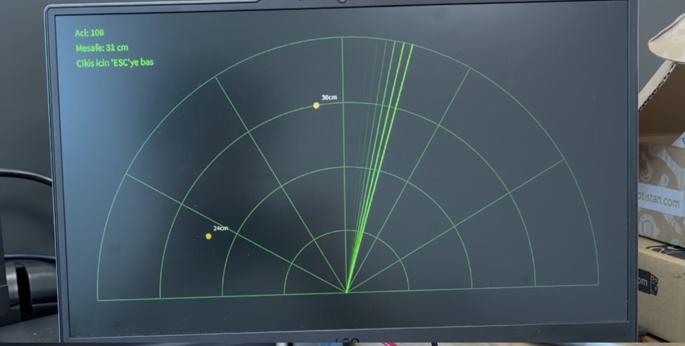
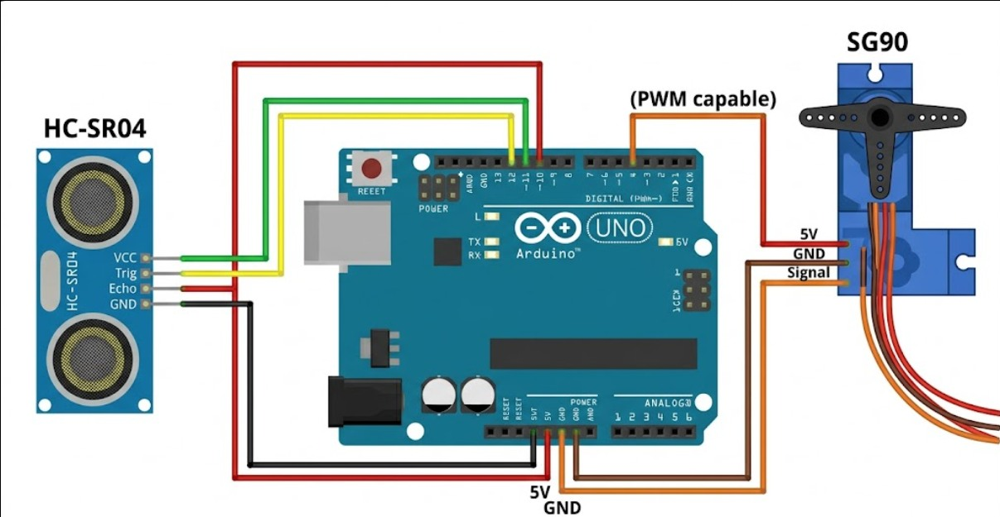
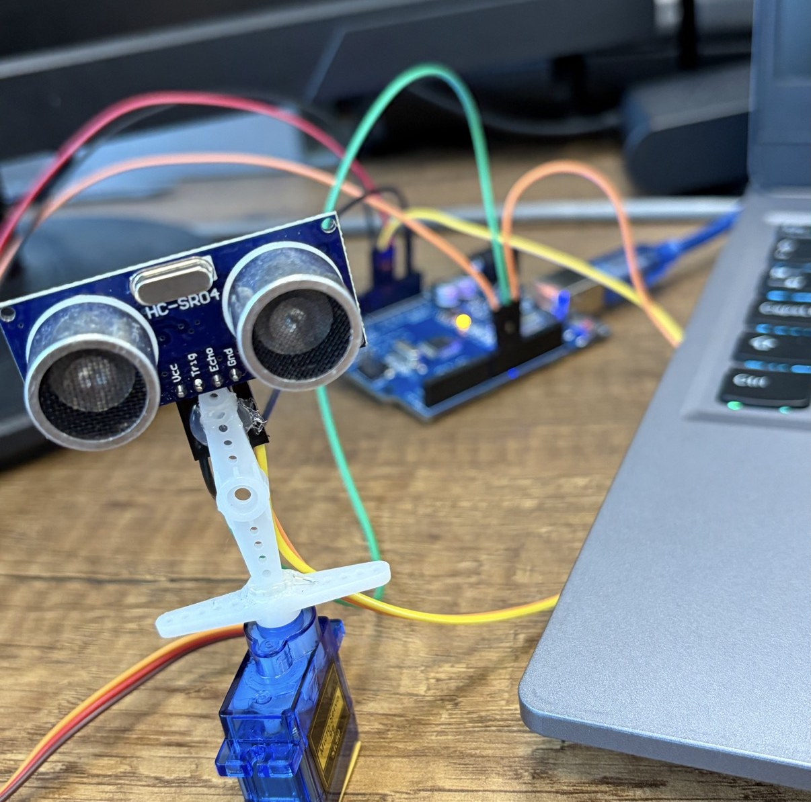
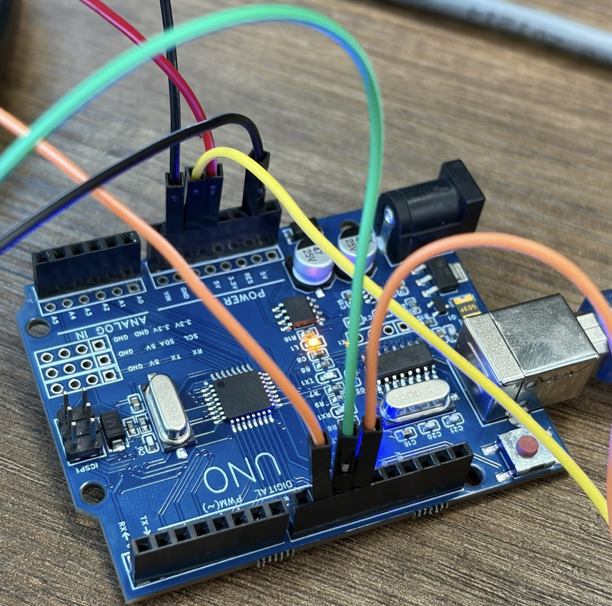

<div align="center">
  <h1>Smart Radar System</h1>
  <p><strong>Arduino UNO R3, an ultrasonic sensor, a servo motor, and a live Processing display.</strong></p>
  <p></p>
  <p><em>The display plots nearby objects as yellow targets while the green radar beam sweeps across the field of view.</em></p>
</div>

## Project Overview

This project combines an Arduino UNO R3, an HC-SR04 ultrasonic sensor, and an SG90 servo with a desktop visualization built in Processing. The servo sweeps the sensor from 0 to 180 degrees. At each step, the Arduino measures distance and sends an angle-distance pair to the computer over USB serial. Processing turns that stream into a radar-style display with a green sweep and fading yellow target trails.

Objects closer than 40 cm are marked on the screen. The trail effect fades over roughly two seconds at the sketch's default frame rate.

## How It Works

1. The SG90 moves the HC-SR04 through the 0-180 degree scan, in 2-degree steps.
2. The sensor measures the distance at each angle.
3. The Arduino sends each reading as `angle,distance.` at 9600 baud.
4. The Processing sketch reads each period-terminated message and updates the sweep.
5. Readings below 40 cm create yellow markers that fade from the display.

## Components

- Arduino UNO R3 or a compatible UNO board
- HC-SR04 ultrasonic distance sensor
- SG90 180-degree servo motor
- Jumper wires
- USB connection to a computer
- Arduino IDE and Processing IDE

## Wiring

| Component | Pin / wire | Arduino connection |
| --- | --- | --- |
| HC-SR04 | VCC | 5V |
| HC-SR04 | TRIG | D10 |
| HC-SR04 | ECHO | D11 |
| HC-SR04 | GND | GND |
| SG90 | Signal (orange/yellow) | D9 |
| SG90 | VCC (red) | 5V |
| SG90 | GND (brown/black) | GND |

<p align="center"></p>
<p align="center"><em>Wiring diagram for the sensor and servo connections.</em></p>

If the servo causes resets or unstable readings when powered from the board, use a suitable regulated 5 V supply for the servo and connect its ground to Arduino GND.

## Software and Setup

### Arduino

1. Open [`SmartRadar.ino`](arduino/SmartRadar/SmartRadar.ino) in the Arduino IDE.
2. Select your UNO board and the correct serial port.
3. Upload the sketch. It uses D10 for TRIG, D11 for ECHO, D9 for the servo signal, and 9600 baud for serial data.

### Processing

1. Open [`SmartRadar.pde`](processing/SmartRadar/SmartRadar.pde) in Processing.
2. Change `SERIAL_PORT` from `COM5` to the port used by your Arduino, if needed.
3. Make sure the baud rate remains 9600, matching the Arduino sketch.
4. Close the Arduino Serial Monitor, then run the Processing sketch. Press **ESC** to exit the full-screen display.

## Code

The project has two coordinated programs: the Arduino sketch reads the sensor and controls the servo; the Processing sketch parses the serial stream and renders the radar interface.

<details>
<summary>View the Arduino sketch</summary>

```cpp
#include <Servo.h>

const int TRIG_PIN = 10;
const int ECHO_PIN = 11;
const int SERVO_PIN = 9;

Servo radarServo;
int angle = 0;
int distanceCm = 0;

int measureDistanceCm() {
  digitalWrite(TRIG_PIN, LOW);
  delayMicroseconds(2);
  digitalWrite(TRIG_PIN, HIGH);
  delayMicroseconds(10);
  digitalWrite(TRIG_PIN, LOW);

  long duration = pulseIn(ECHO_PIN, HIGH);
  int cm = duration * 0.034 / 2;
  return cm;
}

void setup() {
  Serial.begin(9600);
  pinMode(TRIG_PIN, OUTPUT);
  pinMode(ECHO_PIN, INPUT);
  radarServo.attach(SERVO_PIN);
}

void loop() {
  for (angle = 0; angle <= 180; angle += 2) {
    radarServo.write(angle);
    delay(30);
    distanceCm = measureDistanceCm();
    Serial.print(angle);
    Serial.print(',');
    Serial.print(distanceCm);
    Serial.print('.');
  }

  for (angle = 180; angle >= 0; angle -= 2) {
    radarServo.write(angle);
    delay(30);
    distanceCm = measureDistanceCm();
    Serial.print(angle);
    Serial.print(',');
    Serial.print(distanceCm);
    Serial.print('.');
  }
}
```

</details>

<details>
<summary>View the Processing sketch</summary>

```java
import processing.serial.*;

Serial radarPort;
String serialData = "";
float angle = 0;
float distanceCm = 0;
int lastTrailTime = 0;
ArrayList<ObjectTrail> trails = new ArrayList<ObjectTrail>();

final String SERIAL_PORT = "COM5";  // Change this to the port used by your Arduino
final int SERIAL_BAUD = 9600;

void setup() {
  fullScreen();
  smooth();
  radarPort = new Serial(this, SERIAL_PORT, SERIAL_BAUD);
  radarPort.bufferUntil('.');
}

void draw() {
  fill(0, 15, 0, 80);
  noStroke();
  rect(0, 0, width, height);

  drawRadarGrid();
  drawRadarSweep();

  for (int i = trails.size() - 1; i >= 0; i--) {
    ObjectTrail trail = trails.get(i);
    trail.display();
    if (trail.isExpired()) trails.remove(i);
  }

  if (distanceCm > 0 && distanceCm < 40) {
    if (millis() - lastTrailTime > 1000) {
      trails.add(new ObjectTrail(angle, distanceCm));
      lastTrailTime = millis();
    }
  }

  drawStatus();
}

void drawRadarGrid() {
  stroke(0, 80, 0);
  strokeWeight(2);
  noFill();

  int centerX = width / 2;
  int baseline = height - 100;
  float radarRadius = height * 0.8;

  for (int r = 1; r <= 4; r++) {
    float radius = (radarRadius / 4) * r;
    arc(centerX, baseline, radius * 2, radius * 2, PI, TWO_PI);
  }
}

void drawRadarSweep() {
  stroke(30, 255, 30);
  strokeWeight(3);

  int centerX = width / 2;
  int baseline = height - 100;
  float radarRadius = height * 0.8;
  float radiansAngle = radians(angle);

  line(centerX, baseline,
       centerX - radarRadius * cos(radiansAngle),
       baseline - radarRadius * sin(radiansAngle));
}

void drawStatus() {
  fill(30, 255, 30);
  textSize(24);
  text("Angle: " + (int) angle, 50, 50);
  text("Distance: " + (int) distanceCm + " cm", 50, 90);
  text("Press ESC to exit", 50, 130);
}

void serialEvent(Serial port) {
  serialData = port.readStringUntil('.');
  if (serialData != null) {
    serialData = trim(serialData);
    int commaIndex = serialData.indexOf(',');
    if (commaIndex > 0) {
      angle = float(serialData.substring(0, commaIndex));
      distanceCm = float(serialData.substring(commaIndex + 1));
    }
  }
}

class ObjectTrail {
  float x;
  float y;
  float distanceCm;
  float opacity = 255;

  ObjectTrail(float angleDegrees, float distance) {
    float scale = (height * 0.8) / 40.0;
    float radiansAngle = radians(angleDegrees);
    x = (width / 2) - (distance * scale) * cos(radiansAngle);
    y = (height - 100) - (distance * scale) * sin(radiansAngle);
    distanceCm = distance;
  }

  void display() {
    stroke(255, 255, 0, opacity);
    strokeWeight(15);
    point(x, y);

    fill(255, 255, 255, opacity);
    textSize(18);
    text((int) distanceCm + " cm", x + 15, y - 15);
    opacity -= 2.1;
  }

  boolean isExpired() {
    return opacity <= 0;
  }
}
```

</details>

## Build Photos

<table>
  <tr>
    <td align="center" width="50%"><br><em>Ultrasonic sensor and servo assembly.</em></td>
    <td align="center" width="50%"><br><em>Arduino UNO and jumper-wire connections.</em></td>
  </tr>
</table>

## Original Project Article

This repository documents my project in English. For the original Turkish article and additional background, see [Smart Radar System with UNO R3 and Processing: Detect and Track Objects](https://maker.robotistan.com/uno-r3-ve-processing-ile-akilli-radar-sistemi-nesneleri-yakala-ve-takip-et/).
